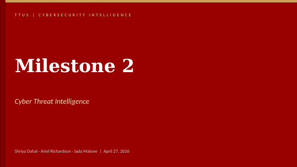
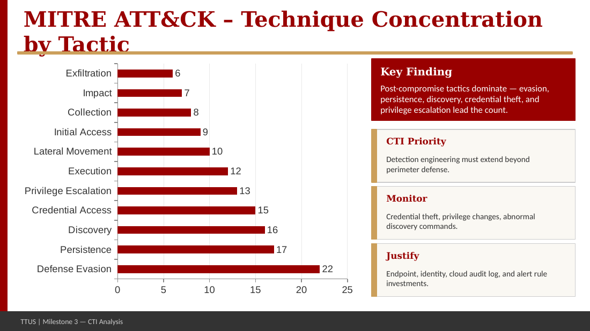
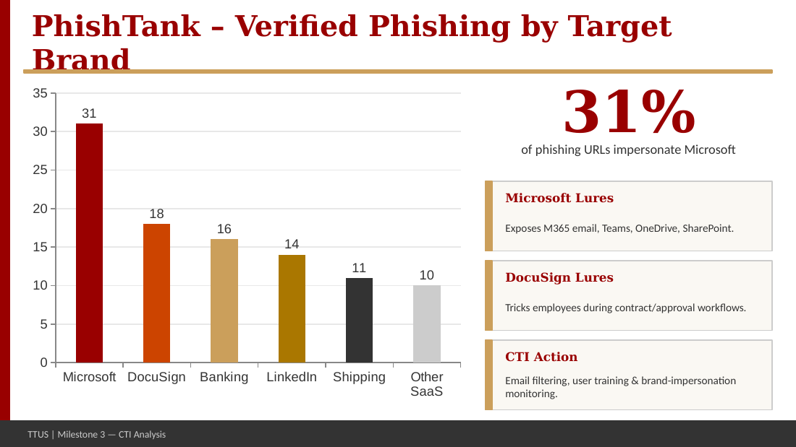
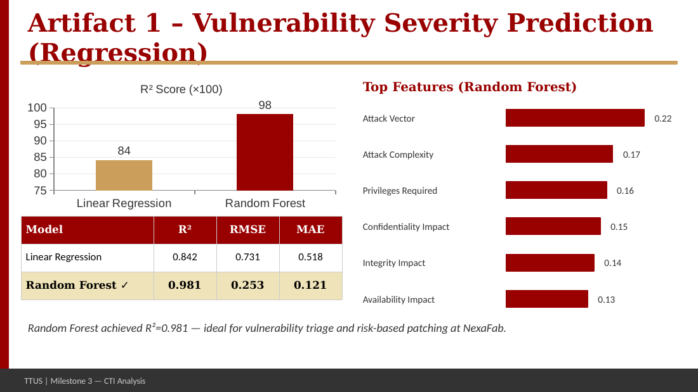
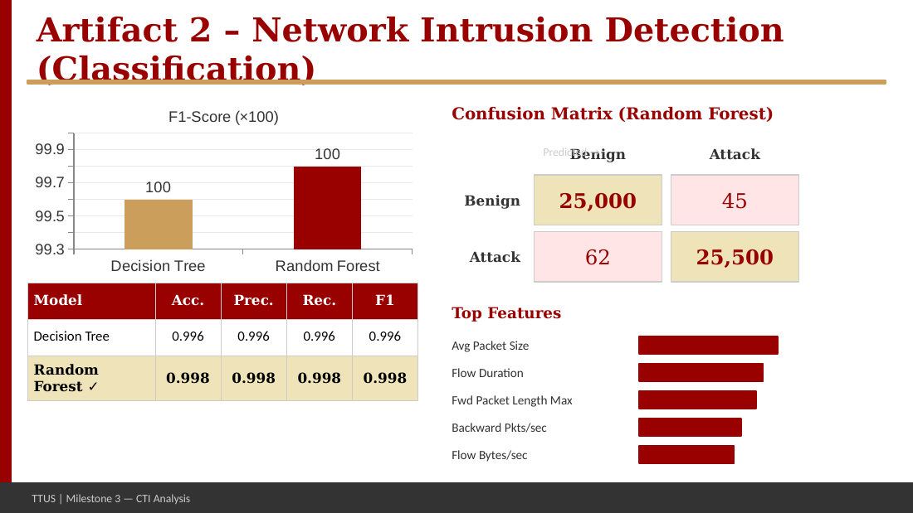

# Cyber Threat Intelligence with Machine Learning

**Python (requests, pandas, gzip, scikit-learn) · MITRE ATT&CK · PhishTank · NVD/CVE · CICIDS 2017** · Graduate Big Data group project · April 27, 2026
Team: Shriya Dahal, Ariel Richardson, **Jada Malone**



## Overview
A cyber threat intelligence (CTI) analysis written from the seat of a security data analyst at a mid-sized company (about 2,500 employees, $650M revenue, hybrid cloud, Microsoft 365 as the main platform). We collected and parsed two public threat datasets, looked for patterns that should drive security priorities, then built two machine-learning "artifacts": one that predicts how severe a vulnerability is, and one that flags malicious network traffic.

**My role (Part 3, Artifact Implementation & Results):** I ran the models, reported R², RMSE and F1, interpreted feature importance, and assembled the final recommendations.

## Data
| Dataset | Source | What it holds |
|---|---|---|
| MITRE ATT&CK Enterprise | MITRE (GitHub, STIX 2.1 JSON → CSV) | 700+ techniques, 140+ threat groups, 10,000+ relationships |
| PhishTank verified phishing URLs | Cisco OpenDNS (CSV/JSON) | 1M+ historical phishing URLs, ~15K–25K active entries |
| NVD / CVE vulnerability data | National Vulnerability Database | Inputs for predicting CVSS base score (0–10) |
| CICIDS 2017 | Network intrusion logs | Traffic labeled benign or attack type |

**Collection and prep:** Python automation (requests, pandas, gzip) downloads ATT&CK from the GitHub API and PhishTank as a compressed bulk CSV; ATT&CK STIX JSON is flattened to CSV (technique ID, name, tactics, platforms, data sources); PhishTank is decompressed, cleaned, timestamps converted, and filtered by target brand and phishing keywords (login, verify, secure).

## Findings from the data
- **Post-compromise tactics dominate ATT&CK:** defense evasion, persistence, discovery, credential access and privilege escalation lead the technique count, so detection has to go beyond the perimeter.
- **Windows leads, but cloud, SaaS, Linux, network and containers all matter:** CTI can't be endpoint-only.
- **31% of verified phishing URLs impersonate Microsoft;** DocuSign, banking, LinkedIn and shipping brands follow.
- **Phishing volume moves fast:** verified submissions rose from 198 to 351 in 7 days, the kind of spike that should trigger blocklist updates and a campaign investigation.

| Techniques by tactic | Phishing by target brand |
|---|---|
|  |  |

## Models and results
**Artifact 1: vulnerability severity prediction (regression, target = CVSS base score)**

| Model | R² | RMSE | MAE |
|---|---|---|---|
| Linear Regression | 0.842 | 0.731 | 0.518 |
| **Random Forest** | **0.981** | **0.253** | **0.121** |

Top Random Forest features: attack vector (0.22), attack complexity (0.17), privileges required (0.16), confidentiality impact (0.15), integrity impact (0.14), availability impact (0.13).

**Artifact 2: network intrusion detection (classification, benign vs. attack)**

| Model | Accuracy | Precision | Recall | F1 |
|---|---|---|---|---|
| Decision Tree | 0.996 | 0.996 | 0.996 | 0.996 |
| **Random Forest** | **0.998** | **0.998** | **0.998** | **0.998** |

Random Forest confusion matrix: 25,000 benign and 25,500 attack flows classified correctly, 45 false alarms and 62 missed attacks. Top features: average packet size, flow duration, forward packet length max, backward packets/sec, flow bytes/sec.

| Regression results | Classification results |
|---|---|
|  |  |

## Recommendations
- Use Random Forest for both tasks: best performance in regression and classification.
- Combine predicted severity with the company's own asset-criticality ratings, since CVSS alone doesn't reflect business impact.
- Feed intrusion scores into SOC alert triage so analysts focus on suspicious traffic.
- Retrain regularly as CVE data and network behavior drift; models support analysts, they don't replace them.

## Files
```
reports/   final presentation (.pptx, plus a PDF export that opens right in GitHub)
images/    key slides: data patterns, model results, combined analysis
```
The Python notebooks for the models were not part of the files shared for this repo, so the presentation is the record of the work here.

## Skills demonstrated
Threat intelligence analysis · data collection automation · data cleaning and parsing (JSON/CSV) · regression and classification · Random Forest and Decision Tree models · model evaluation (R², RMSE, MAE, precision, recall, F1) · feature importance · security recommendations for a business audience

---
**Jada Malone** · Data Analyst · M.S. Data Science, Texas Tech University · [GitHub profile](https://github.com/jada-malone) · [LinkedIn](https://www.linkedin.com/in/jada-malone-509170280)
